# Astro Dashboard

A WordPress-style admin dashboard for [Astro](https://astro.build) sites that runs inside VS Code. You can manage content collections, entries, media, pages and site config in forms instead of editing Markdown front matter and TypeScript by hand.

Everything is saved as normal files in your project. There's no database, no server and no lock-in: you can keep editing the same files in the code editor, and the dashboard updates when they change.

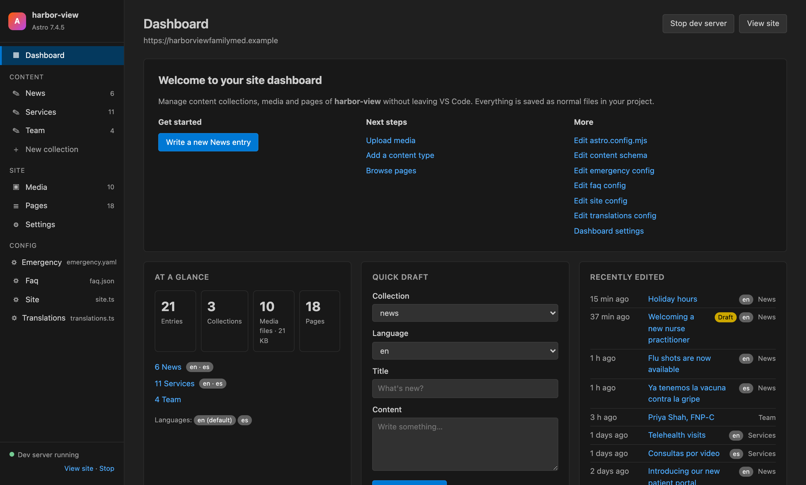

---

## Contents

- [Getting started](#getting-started)
- [Tutorial](#tutorial)
- [Opening the dashboard](#opening-the-dashboard)
- [Dashboard home](#dashboard-home)
- [Content collections](#content-collections)
- [Editing an entry](#editing-an-entry)
- [Translations](#translations)
- [Creating a new collection](#creating-a-new-collection)
- [Media library](#media-library)
- [Pages](#pages)
- [Config files](#config-files)
- [Settings view](#settings-view)
- [Dev server](#dev-server)
- [Keyboard shortcuts](#keyboard-shortcuts)
- [Extension settings](#extension-settings)
- [How it works](#how-it-works)
- [Notes and limits](#notes-and-limits)
- [Development](#development)

---

## Getting started

**Requirements:** VS Code 1.90 or newer, and a workspace containing an Astro project (a folder with `astro.config.mjs`, `.js`, `.ts`, `.mts` or `.cjs`).

**Install from a `.vsix` file:**

```sh
code --install-extension astro-dashboard-0.1.0.vsix
```

Or in VS Code: Extensions view → `…` menu → **Install from VSIX…**

The extension starts on its own when the workspace contains an `astro.config.*` file. If the workspace holds more than one Astro project, it asks which one to use the first time you open the dashboard.

> For the best results, run `astro sync` (or start the dev server) once. The dashboard then reads the exact field types from Astro's generated `.astro/collections/*.schema.json` files.

**New here?** Follow the [tutorial](#tutorial). It walks through every feature using the example site in this repo.

## Tutorial

This walk-through uses the example site in [`example/`](example/), *Harbor View Family Medicine*: a fictional family practice in San Diego with an English site and a Spanish version under `/es/`. It takes about 15 minutes and covers every part of the dashboard. Everything you change is a normal file edit, so you can see each change in `git diff` as you go.

### 1. Set up the example

```sh
cd example
npm install
npm run sync    # lets the dashboard read the exact field types
```

Open the `example` folder in VS Code with the extension installed. If you're working on the extension itself, press **F5** in the extension repo instead. It opens the example in an Extension Development Host.

### 2. Open the dashboard and start the site

Click the **Astro Dashboard** icon in the activity bar, or **Dashboard** in the status bar. The home screen shows what's in the project: 3 collections (News, Services, Team), 10 media files, 18 pages and 4 config files.

At the bottom of the left menu, click **Start**. This runs `astro dev` in a terminal called *Astro dev*. Once it's up, the menu shows **Dev server running**, and **View site** opens http://localhost:4321 inside VS Code.


### 3. Edit a news post

1. In the menu, click **News**. The list shows one column per language: ✓ means the translation exists and **+** means it's missing. *Welcoming a new nurse practitioner* has a **Draft** badge.

   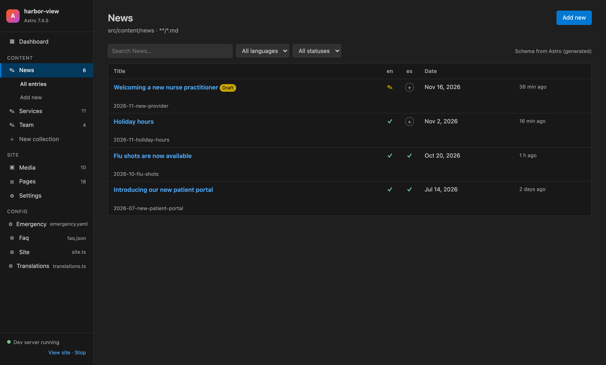

2. Click **Flu shots are now available**. On the left is the Markdown body, on the right the publish box, the translations box and the fields from the schema: date, summary, cover image, tags and the *important* checkbox.

   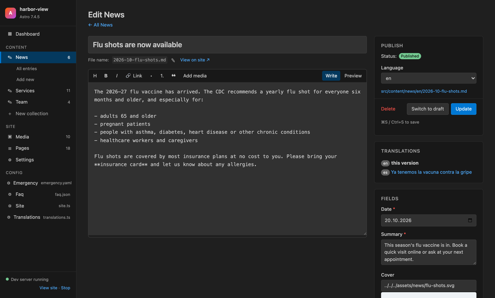

3. Change the summary, then click **Update** (or press `⌘S` / `Ctrl+S`). Open `src/content/news/en/2026-10-flu-shots.md`: only the `summary:` line changed.
4. Click **View on site ↗** to see the post at `/news/2026-10-flu-shots/`.

### 4. Link to another page

In the post body, put the cursor at the end of the last line and press `⌘K` / `Ctrl+K`. The link picker lists every page and post of the site in the selected language, with its URL. Pick **Office hours** and click **Insert link**. The dashboard writes `[Office hours](/hours/)` for you.

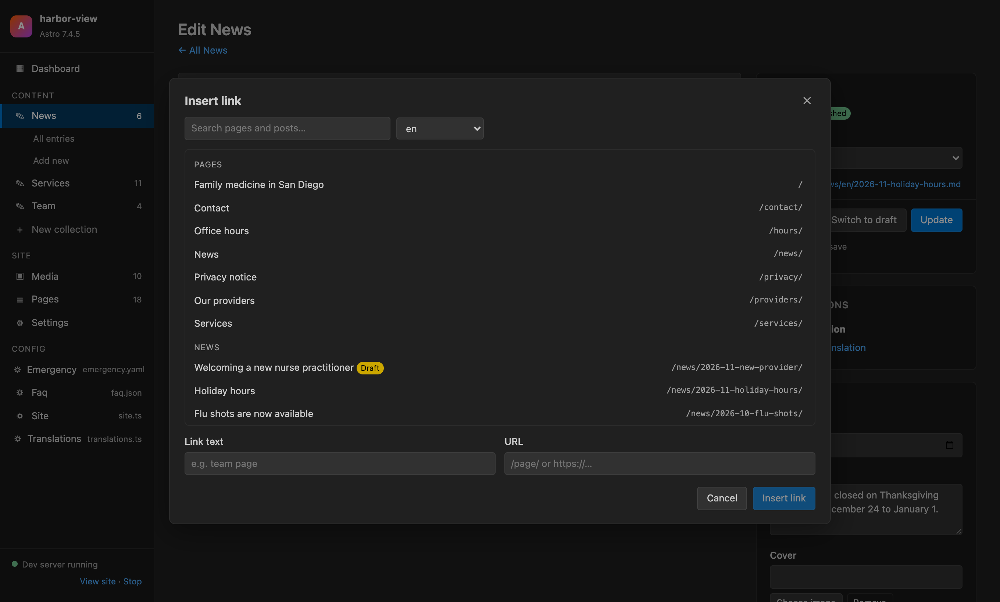

Next to **Link**, **Add media** inserts an image from the media library with the correct relative path.

### 5. Translate a post into Spanish

1. Go back to **News**. *Holiday hours* has a **+** in the **es** column.
2. Click **+**. The dashboard copies the post to `src/content/news/es/2026-11-holiday-hours.md` and opens it.
3. Translate the title, summary and body, for example *Horario de días festivos*, and click **Update**.
4. The Spanish post is now live at `/es/noticias/2026-11-holiday-hours/`. In the editor's **Translations** box, you can jump between the two versions.

### 6. Publish a draft

Open *Welcoming a new nurse practitioner*. The publish box shows **Draft**. Click **Publish**, and the `draft: true` line is removed from the file. The post now appears on `/news/`.

Services has no draft field. Open any service and click **Enable drafts** next to the status. The dashboard adds `draft: z.boolean().default(false)` to the services schema in `src/content.config.ts`. Your pages still decide what to do with drafts. In the example, `getNews()` in `src/lib/news.ts` already skips them.

### 7. Edit a team member

**Team** is a data collection: one YAML file per person and no body text, so the editor only shows fields.

1. Click **Team**, then **Daniel Reyes, MD**.
2. *Role* is a drop-down (from `z.enum`), *Languages* is a tag list, and *Photo* is an image picker. *Position* is an object with `en` and `es` values, so it's edited as JSON.
3. Add **Português** to *Languages* and click **Update**. Reload `/providers/` to see it.

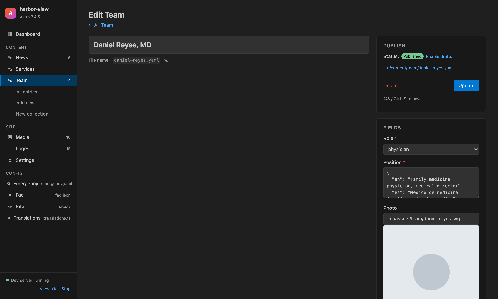

To add someone, click **Add new** under Team. Fill in the fields, pick a headshot with **Choose image**, and save. The new file goes to `src/content/team/<name>.yaml`.

### 8. Manage media

Click **Media**. Every file in `src/assets` and `public` is shown as a tile.

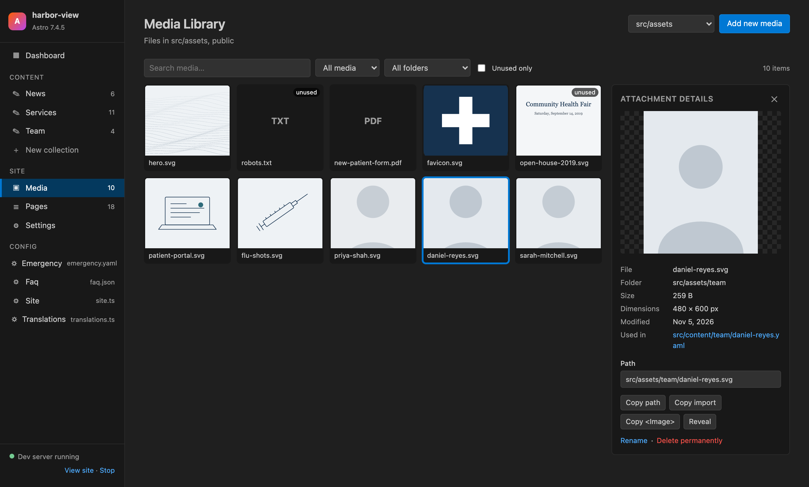

- Click a file to see its size, dimensions and **Used in**: the files that reference it. Copy its path, an `import` line or an `<Image>` tag.
- Tick **Unused only**. `open-house-2019.svg` is an old flyer nobody uses, so you can safely delete it.
- Drag an image onto the page, or click **Add new media**, to upload it to the folder picked next to the button. For example, upload a headshot to `src/assets/team` and choose it as Maria Lopez's photo.

### 9. Change site settings without touching code

The **Config** section of the menu lists the files the site keeps its settings in.

1. Click **Site** (`src/data/site.ts`). Each export is a tab: *Practice*, *Hero*, *Notice*, *Hours*, *Closures* and *Insurance*.

   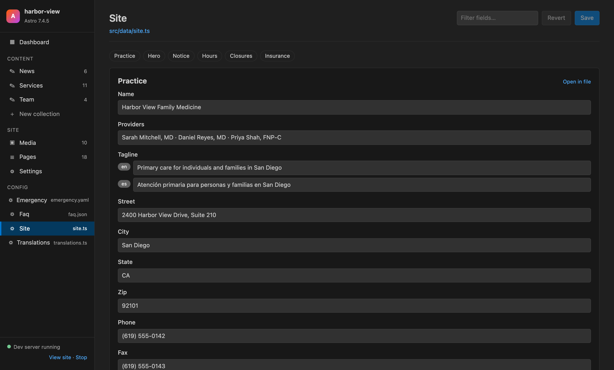

2. Open **Notice**, untick **Show** and click **Save**. The notice bar disappears from every page.
3. Open **Hours**. Each item is one day (`day: 4` is Thursday). Change Thursday's afternoon closing time from `19:00` to `20:00`.
4. Open **Insurance** and duplicate the last plan to add another one.
5. Scroll to **Hero**. `image` is an imported image, so it's shown read-only with a thumbnail and an **Edit in file** link.

Run `git diff src/data/site.ts`. Only the values you changed are different, and comments and formatting are untouched.

**Translations** (`src/i18n/translations.ts`) holds the menu labels and interface texts. English and Spanish are shown side by side, so missing or outdated translations are easy to spot.

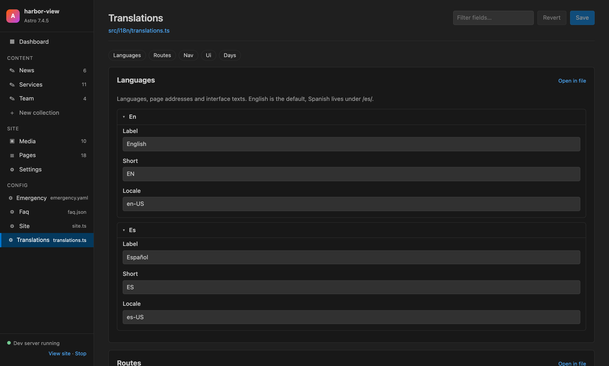

**Faq** (`faq.json`) and **Emergency** (`emergency.yaml`) work the same way for JSON and YAML files.

### 10. Add a new content type

Say the practice wants a page of patient forms.

1. Click **New collection**. Name it `downloads`, keep **Translatable** ticked and adjust the fields. The code preview shows what will be added.

   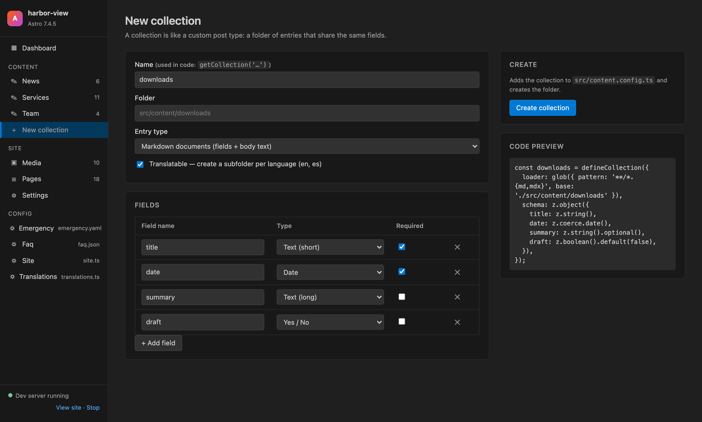

2. Click **Create collection**. The dashboard adds `defineCollection(...)` to `src/content.config.ts` and creates `src/content/downloads/en/` and `es/`.
3. Restart the dev server (or run `npm run sync`). **Downloads** now appears in the menu, and you can add entries.
4. To show them on the site, add a page, for example `src/pages/downloads.astro`:

   ```astro
   ---
   import { getCollection } from 'astro:content';
   import Base from '../layouts/Base.astro';
   const items = await getCollection('downloads', (d) => d.id.startsWith('en/'));
   ---
   <Base lang="en" title="Patient forms">
     <section class="section"><div class="wrap">
       <h1>Patient forms</h1>
       <ul>{items.map((d) => <li>{d.data.title}</li>)}</ul>
     </div></section>
   </Base>
   ```

### 11. Check pages and settings

- **Pages** lists every route in `src/pages` with its URL, language and type. In the example that's 7 pages in each language, 2 dynamic routes for the news posts, a 404 page and the `/api/hours.json` endpoint.

  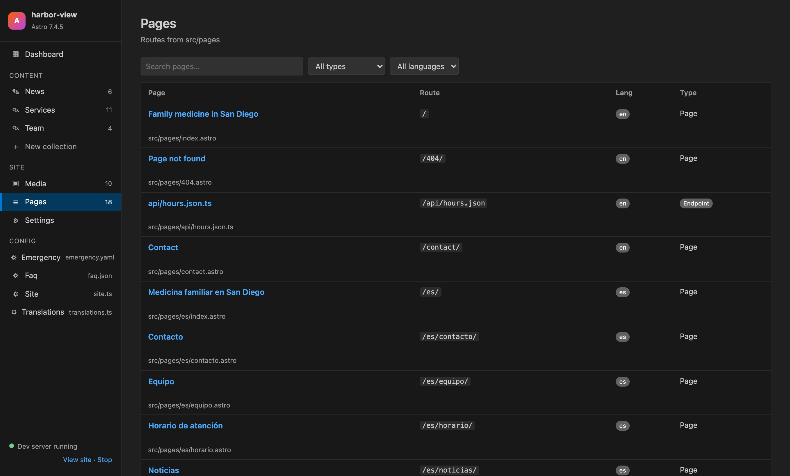

- **Settings** shows what the dashboard read from `astro.config.mjs` (site URL, languages, integrations) and each collection's fields.

When you're done, run `git checkout example/ && git clean -fd example/` to reset the example site.

## Opening the dashboard

You can open the dashboard in any of these ways:

| Where | How |
| --- | --- |
| **Activity bar** (left sidebar) | Click the  **Astro Dashboard** icon. The dashboard opens in an editor tab, and the side panel offers quick buttons: *Open Dashboard*, *New Entry*, *Media Library*, *Site Config*. |
| **Status bar** | Click **Dashboard** in the bottom-left corner. |
| **Editor title bar** | Click the dashboard icon at the top right of any editor. |
| **Command palette** | `⌘⇧P` / `Ctrl+Shift+P` → **Astro: Open Dashboard** |

These commands are also in the command palette:

| Command | What it does |
| --- | --- |
| **Astro: Open Dashboard** | Opens the dashboard home |
| **Astro: New Content Entry** | Opens a blank entry form (asks for the collection if there are several) |
| **Astro: New Content Collection (Post Type)** | Opens the new-collection wizard |
| **Astro: Open Media Library** | Opens the media library |
| **Astro: Open Site Config** | Opens the config file editor |

The dashboard opens as a single **Dashboard** tab. Opening it again brings the existing tab to the front, and it remembers which view you were on.

## Dashboard home


The home screen gives you a summary of the site:

- **Welcome panel:** a shortcut to write a new entry, plus links to upload media, add a content type, browse pages, and open `astro.config`, the content schema or config files.
- **At a glance:** number of entries, collections, media files (with total size) and pages, plus the languages the site uses.
- **Quick draft:** pick a collection and language, type a title and some text, then **Continue editing** to open the full editor with that text filled in.
- **Recently edited:** the latest changed entries across all collections, with language and collection.
- **Recent media:** thumbnails of recent images.
- **Dev server status:** whether `astro dev` is running, with buttons to start, stop or view the site.

The left menu stays the same on every screen. It has **Content** (one item per collection), **Site** (Media, Pages, Settings) and **Config** (the config files found in your project).

## Content collections


Each content collection defined in `src/content.config.ts` gets its own menu item, the same way each post type does in WordPress. The list shows:

- the title and file name of every entry, newest first
- a **language column per locale** for translatable collections: ✓ means the translation exists, **+** creates it
- the date field (if the collection has one) and when the file was last changed
- a **Draft** badge for entries with `draft: true`

Use the search box and the language and status filters to narrow the list. Hover a row for its actions: **Edit**, **Duplicate**, **Open file** (in the normal text editor) and **Delete** (asks for confirmation first).

Above the list you can see where the field info came from: *Schema from Astro (generated)*, *Schema from content config*, or *Schema from existing entries*.

## Editing an entry


The entry editor is generated from the collection's schema:

- **Title** at the top, and the **file name** (slug) below it. Click ✎ to rename the file. For new entries the slug follows the title.
- **Markdown editor** with a toolbar: heading, bold, italic, link, bullet and numbered lists, quote, and **Add media**, which inserts an image from the media library with the correct relative path. Switch between **Write** and **Preview**.
- **Publish box:** status (Published / Draft), language, the file path (click to open it in the editor), and the **Update**, **Switch to draft** and **Delete** buttons. If the collection has no `draft` field, the dashboard offers to add one to the schema.
- **Translations box:** links to the other language versions, or **+** to create a missing one as a copy.
- **Fields box:** one input per schema field. Required fields are marked with *.
- **View on site** opens the entry's page (in VS Code's built-in browser; Alt+click opens your normal browser).

Supported field types:

| Schema | Input |
| --- | --- |
| `z.string()` | Text |
| long strings (e.g. `summary`, `description`) | Text area |
| `z.number()` | Number |
| `z.boolean()` | Checkbox |
| `z.date()` / `z.coerce.date()` | Date picker |
| `z.enum([...])` | Drop-down |
| `z.array(z.string())` | Tags |
| `image()` | Image picker with preview |
| anything else | Raw JSON |

Saving keeps your YAML front matter tidy. The key order and formatting stay the same, and boolean fields that are set to their default value are left out.

**Linking:** press `⌘K` / `Ctrl+K`, or click **Link**, to open the link picker. It lists every page and entry of the site, so you can link to them without typing URLs.


**Data collections** (JSON or YAML files, no body text) open with just the fields:


## Translations

If your Astro config sets `i18n.locales`, collections with one subfolder per language (`src/content/news/en/…`, `src/content/news/es/…`) are recognised as translatable. The dashboard then:

- shows a column per language in the entry list
- lets you pick the language in the publish box and in Quick draft
- creates a missing translation from the original entry with one click (the copy goes into the right language folder with the same slug)
- links between the language versions in the editor

## Creating a new collection


**New collection** works like *Add post type* in WordPress:

1. Enter a **name**. This is the name you use in code: `getCollection('name')`.
2. Choose the **folder** (defaults to `src/content/<name>`) and the **entry type**: Markdown documents (fields + body text) or data only (JSON/YAML, no body text).
3. Tick **Translatable** to create one subfolder per language.
4. Add, remove and set up the **fields**: name, type and whether they're required.
5. Check the **code preview**, then click **Create collection**.

The dashboard adds the `defineCollection(...)` code to your `src/content.config.ts`, registers it in `collections`, and creates the folder.

> A new collection only adds the schema and the folder. To show it on your site you still need a page that calls `getCollection('name')`. Restart the dev server (or run `astro sync`) so Astro picks up the new collection and its types.

## Media library


The media library shows every file in your media folders (by default `src/assets` and `public`) in a grid:

- **Upload** with the **Add new media** button or by dragging files onto the page. Pick the target folder from the drop-down next to the button.
- **Filter** by name, type (images, video, audio, documents) or folder, or tick **Unused only** to find files nobody references. Unused files have an *unused* badge.
- **Click a file** to see its details: folder, size, image dimensions, modified date, and **Used in**, the source files that reference it (click to open them).
- **Copy path** or **Copy URL**, and copy ready-made code: an `import` statement or an `<Image>` tag for `src/assets` images, or a `/public` URL for public files.
- **Reveal** the file in the Explorer, **Rename** it, or **Delete** it. Before deleting you get a warning if the file is still used somewhere.

## Pages


**Pages** lists every route in `src/pages`, with:

- the page title (read from the page when possible) and file
- the URL it's served at, including the site's base path
- its language (from the folder, such as `en/`)
- its type: *Page*, *Dynamic* (`[id].astro`, `[...slug].astro`) or *Endpoint*

Search and filter by type or language. **Edit** opens the `.astro` file, **View** opens the page in the browser (if the dev server is running), and **Copy URL** copies the route.

## Config files


Many Astro sites keep content in TypeScript or JSON files, such as the site name, opening hours, team members, navigation labels or translations. The dashboard finds these files on its own (for example `src/data/site.ts`, `src/i18n/translations.ts` or `src/data/*.json`) and lists them under **Config** in the menu. Each one opens as a form, the way a WordPress theme's Customizer does:

- Every exported value becomes a section. The tabs at the top jump between them.
- **Text, numbers and yes/no** values become inputs.
- **Translation pairs** such as `{ en: '…', es: '…' }` are shown side by side.
- **Lists** can be added to, duplicated, reordered and removed. New items are copies of the last one.
- **Filter fields** finds a field by name or value.
- Values that are code, such as `import.meta.env.SITE`, function calls or imported images, are shown read-only with an **Edit in file** link to the exact line. Imported images still show a thumbnail.

Saving only rewrites the values you changed. Comments, formatting and everything else in the file stay the same. Use `⌘S` / `Ctrl+S` or the **Save** button, and **Revert** to throw away unsaved changes.


To list files the dashboard doesn't find, add them to the `astroDashboard.configFiles` setting.

## Settings view

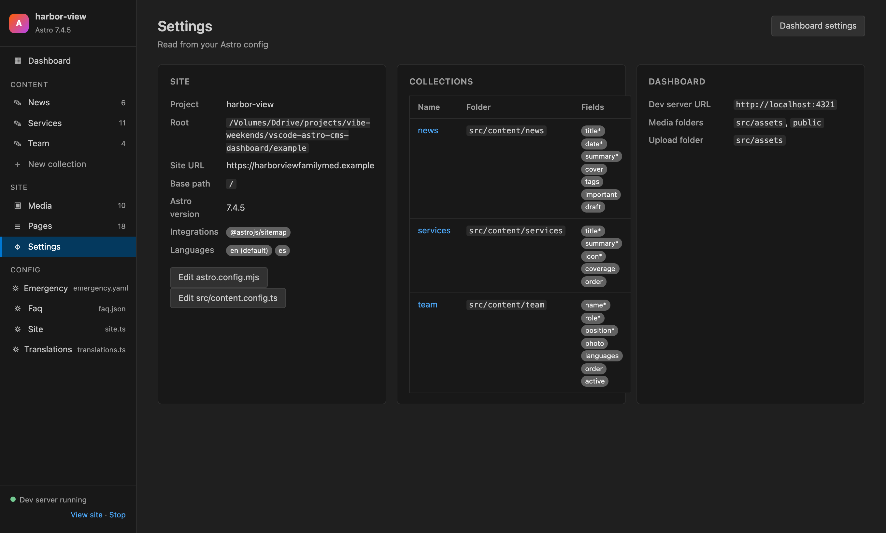

**Settings** shows what the dashboard read from your project:

- **Site:** project name, root folder, site URL, base path, Astro version, integrations and languages, with buttons to open `astro.config` and `src/content.config.ts`
- **Collections:** each collection with its folder and fields (* = required)
- **Dashboard:** the current extension settings. **Dashboard settings** opens them in VS Code's settings editor.

## Dev server

The dashboard checks whether the Astro dev server is running at `astroDashboard.devServerUrl` (default `http://localhost:4321`). The status is shown at the bottom of the menu and on the home screen.

- **Start** opens a terminal called *Astro dev* and runs `npx astro dev`.
- **Stop** stops that terminal. If the server was started somewhere else, the dashboard tries `astro dev stop` first, then asks before stopping the process.
- **View site** / **View on site** open pages in VS Code's built-in browser. Alt+click opens your normal browser. If the server isn't running, the dashboard offers to start it.

## Keyboard shortcuts

| Shortcut | Where | Action |
| --- | --- | --- |
| `⌘S` / `Ctrl+S` | Entry editor, config editor | Save |
| `⌘K` / `Ctrl+K` | Entry editor | Open the link picker |
| `Esc` | Dialogs | Close |
| Alt+click | File links, View links | Open beside the dashboard / in your normal browser |

## Extension settings

Open them with **Settings** → search for *Astro Dashboard*, or click **Dashboard settings** in the Settings view.

| Setting | Default | Description |
| --- | --- | --- |
| `astroDashboard.openOnStartup` | `false` | Open the dashboard when an Astro project is opened. |
| `astroDashboard.mediaFolders` | `["src/assets", "public"]` | Folders (relative to the project root) shown in the media library. |
| `astroDashboard.defaultUploadFolder` | `"src/assets"` | Where uploaded files go by default. |
| `astroDashboard.devServerUrl` | `"http://localhost:4321"` | Dev server URL, used for status checks and *View* links. |
| `astroDashboard.configFiles` | `[]` | Extra config/data files to list under **Config**, on top of the ones found automatically in `src/`. |

## How it works

The dashboard maps WordPress ideas onto Astro's files:

| WordPress | Astro Dashboard | Stored in |
| --- | --- | --- |
| Dashboard home | Overview | — |
| Posts / custom post types | Content collections | `src/content.config.ts` + `src/content/<name>/` |
| Post editor | Entry editor | Markdown files with YAML front matter (or JSON/YAML data files) |
| Add new post type | New collection wizard | `defineCollection(...)` in `src/content.config.ts` |
| Media library | Media library | `src/assets/`, `public/` |
| Pages | Pages | `src/pages/` |
| Polylang / WPML | Translations | one subfolder per locale |
| Customizer / theme options | Config | `src/data/*.ts`, `src/i18n/*.ts`, `*.json` |
| Settings | Settings | `astro.config.*` (read-only) |

The extension finds field info in this order:

1. Astro's generated JSON schemas in `.astro/collections/*.schema.json` (most exact)
2. parsing the `z.object({...})` schema in your content config
3. looking at the existing entries

The dashboard also watches `src/`, `public/`, `astro.config.*` and the generated schemas. When files change on disk (from the code editor, git or a script), it refreshes on its own. While you're editing an entry it only refreshes the menu, so your unsaved changes stay.

## Notes and limits

- Config values that are code (imports like `photo: photoTomic`, `import.meta.env.SITE`, function calls) can't be edited in the form. Use **Edit in file**. Empty lists are filled in the file first, because new items are copies of an existing one.
- A new collection only adds the schema and folder. Your pages still need to call `getCollection('name')` to show it.
- After adding a collection, restart the dev server (or run `astro sync`) so Astro regenerates its types.
- Renaming media doesn't update references to it. The dashboard warns you which files still use the old name.
- Only one Astro project is open in the dashboard at a time. In a multi-root workspace you pick it the first time you open the dashboard.

## Development

```sh
npm install
npm run build       # bundle to dist/extension.js
npm run watch       # rebuild on change
npm run typecheck   # tsc --noEmit
npm test            # core logic tests against a temp copy of the example site
npm run package     # create astro-dashboard-<version>.vsix
npm run preview:webview   # the dashboard UI in a browser, on the example site
npm run screenshots       # regenerate the screenshots in images/
```

Press **F5** in VS Code with this folder open to launch an Extension Development Host. It opens the example site in [`example/`](example/).

### Example site

[`example/`](example/) is a small, fictional family medicine practice in San Diego (*Harbor View Family Medicine*) in English and Spanish. It is built to show every part of the dashboard: translated and untranslated collections, a data-only collection, drafts, images, unused media, dynamic pages, an endpoint, and config files in TypeScript, JSON and YAML. See [example/README.md](example/README.md) for a tour.

```sh
cd example
npm install
npm run sync        # generate Astro's schemas so the dashboard reads exact field types
npm run dev         # http://localhost:4321
```

The tests copy the example to a temp folder, so running them never changes it.

### Screenshots

The screenshots in `images/` are taken from the example site with `npm run screenshots`. The script runs the real dashboard code (`src/panel.ts`) in Node with a small stand-in for the `vscode` module, shows the webview in headless Chrome with VS Code's Dark Modern colors, and saves each view at 1360×820 @2x. Start the example's dev server first (`cd example && npm run dev`) so the shots show *Dev server running*. To redo only some shots, name them: `npm run screenshots -- media entry`.

`npm run preview:webview` starts the same server on http://localhost:4400/, which is handy for working on the UI in a normal browser. Dialogs that VS Code would show (confirmations, file pickers) are logged to the terminal and answered with *cancel*.

### Code layout

| File | Purpose |
| --- | --- |
| `src/extension.ts` | Activation, commands, activity bar view, status bar button, file watchers |
| `src/panel.ts` | The dashboard webview panel and the request handlers between the UI and disk |
| `src/project.ts` | Reads and writes the Astro project (collections, entries, media, pages). Has no VS Code imports, so it's unit-tested with plain Node. |
| `src/dataFiles.ts` | Finds config/data files and edits their values in place with the TypeScript parser. Only changed values are rewritten. |
| `media/dashboard.js`, `media/dashboard.css` | The dashboard UI: plain JavaScript, styled with the VS Code theme colors |
| `media/activity-icon.svg` | Activity bar icon |
| `test/` | Node test runner tests |
| `example/` | Example Astro site used for the tests, F5 debugging, the tutorial and screenshots |
| `scripts/screenshots/` | Serves the dashboard webview to a browser and captures the README screenshots |

## License

MIT
